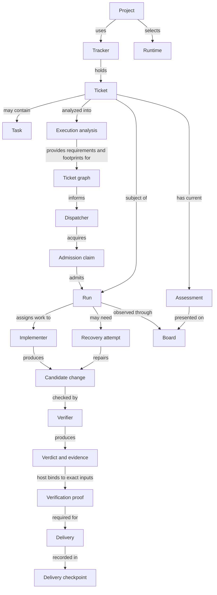

# Factory domain model

Factory coordinates requested work, attempts to perform it and publication of verified changes. These are separate concerns: a selected ticket is not an admitted run, a passing verdict is not delivery authority, and an open PR or MR is not completed work.

This document describes the standard Factory workflow. A complete project workflow override is opaque to Factory's configuration explanation; do not assume its internals follow this model. See [execution context](execution-context.md).

The [glossary](GLOSSARY.md) owns terminology. This document owns the conceptual relationships and worked scenarios, not CLI syntax or configuration schema. The linked feature references own the detailed contracts.

## One domain, several responsibilities

Factory currently uses one shared vocabulary. The boundaries below separate responsibilities within that domain, not independently deployed services or separate glossary contexts.

| Responsibility | Owns | Does not establish |
| --- | --- | --- |
| Work selection and analysis | Selected tickets, execution analyses, dependency and conflict decisions | Permission to start a process |
| Admission and execution | Exclusive claims, capacity, run identity, stages and recovery ownership | Whether the change satisfies the ticket |
| Verification | Independent verdict, evidence and a host-bound verification proof | Merge success or semantic certainty |
| Delivery | Exact published change, required checks, delivery checkpoints and merge observations | Completion merely because a PR exists |
| Operator observation | Assessments, readiness reports, Board presentation and history | Authority to launch or reuse a proof |
| Runtime selection | Complete workflow identity and frozen invocation context | Safety of arbitrary project override code |

## Relationships

The arrows describe relationships, not an unconditional sequence. Each execution, verification and delivery boundary has its own gates.

### Project and ticket identity

A ticket number is meaningful only within its tracker repository or project. Shared state distinguishes projects so similarly numbered tickets cannot share admission authority accidentally.

A parent ticket may describe the overall change while its Tasks are the executable work items. With child-work selection enabled, open Tasks get runs and retain parent requirements as context. A ticket without Tasks remains its own work item. Changing the parent's requirements can invalidate a Task's analysis.

### Dependency and conflict are different relations

A dependency is directed: one ticket requires something another supplies. A conflict is symmetric: their file footprints overlap. Finishing a prerequisite can satisfy a dependency, but a conflict only means the changes must not proceed together while the relevant work remains live.

Execution analysis is stored as a manifest. It records provided and required work, predicted paths and input identities. Once implementation supplies an actual footprint, that footprint replaces the prediction for conflict decisions. A changed ticket or policy identity requires fresh execution analysis.

Dependency information has three states: satisfied, unsatisfied and unknown. Unknown is not satisfied. Both unsatisfied and unknown prerequisites hold dispatch. An open PR or MR can keep its footprint reserved even after the associated run parks.

### Ticket, run and recovery attempt have different lifetimes

A ticket can outlive several execution attempts. The current run record is not a permanent one-record-per-attempt archive: normal admission assigns an execution identity, while historical evidence and journal information are maintained separately.

A recovery attempt operates on a recorded run's saved work rather than starting an unrelated ticket branch. It has its own attempt identity and bounded execution. It uses the shared verification and delivery gates, not an exception to them.

A normal admission claim reserves the ticket and a shared capacity slot. A recovery claim additionally holds the whole project, and its release requires confirmation that the exact owned container is gone. A stopped stage alone is not enough to release that recovery authority.

### Assessment and readiness are observations

An assessment describes the ticket as it is now. The run describes what happened under the inputs chosen for that execution. Refreshing an assessment must not rewrite the historical model choice or result of an existing run.

A readiness observation describes resource access for a particular scope and identity. A saved ready report is not permission to launch. Required blocked or unknown checks hold the corresponding launch path; fresh checks and admission authority remain separate requirements. Host readiness does not establish access for the effective sandbox user.

See [ticket readiness](ticket-readiness.md) for schema, freshness, publication and consumer boundaries, and [image readiness](image-readiness.md) for image-specific contracts.

## Lifecycle and invariants

### Selection is not admission

Selection means a ticket matches the project's policy. Dispatch must still establish current analysis, satisfied dependencies, no conflicting live footprint and available capacity. Admission then claims ownership atomically. Two dispatchers observing a free slot do not both acquire it.

The scheduler triggers dispatch passes; the dispatcher makes ticket-level decisions. The Board displays those decisions but does not grant ownership.

### Stage is not verdict

The standard run stages are:

- `queued` and `waiting`, parked positions that normally do not consume execution capacity.
- `setup`, `implementing`, `verifying`, `posting`, `pushing` and `ci`, active workflow positions.
- `done` and `stopped`, terminal positions for that run record.

This is a vocabulary of positions, not a guarantee that every run visits them in that order. Recovery, external merges and delivery follow-through can produce other transitions. Recovery ownership remains an exception to ordinary parked or terminal capacity release.

A verdict is separately PASS, FAIL or INCONCLUSIVE. A PASS does not mean the PR merged. A stopped run does not establish that its work was never merged outside Factory.

### Evidence is not a proof of correctness

The verifier supplies a structured report and evidence for the acceptance criteria. The host creates a verification proof binding those results to the project, ticket, execution, branch, base, historical baseline, exact candidate revision, requirements and runtime context.

The proof is an integrity and identity record. Structural validation cannot decide whether an agent's explanations and artifacts genuinely demonstrate every requirement. That semantic judgment belongs to independent verification and, where needed, operator review.

### Publication is not merge

The host, not the sandbox agent, performs tracker operations with host credentials. Delivery uses the verified change's exact identity. A PR URL or prose saying "PASS" cannot substitute for a host-owned proof and delivery checkpoint.

A delivery checkpoint can record CI waiting, an operator-required hold or a merge. Continuation must revalidate identity and policy before acting. An already-published change can need host follow-through rather than another repair agent.

The dispatcher reconciles merged work. A Task closes after its work merges; a whole ticket advances to the configured done state; a parent advances when all its Tasks are closed. A closed issue alone is not evidence of a merge.

### Recovery is not an automatic retry of every failure

A queued ticket waiting for capacity is not a jam. Neither is work waiting for analysis, an active run or an external prerequisite. Jam detection identifies selected stopped work and work blocked behind it only when ordinary progress cannot explain the wait.

Recovery is bounded by recorded identity, eligibility, attempt accounting and ownership. It must preserve saved work and evidence, recheck current requirements and use normal verification and delivery gates. Unconfirmed cleanup remains a hold, not a successful reset.

See the [operator recovery contracts](factory-cli.md) for authorization, budgets, settlement and manual controls.

## Scenarios that test the boundaries

| Scenario | Domain interpretation |
| --- | --- |
| Two independent tickets both change the same file | Conflict, even without a dependency. One waits while the other's footprint remains reserved. |
| A ticket requires another ticket's change, but the tracker read fails | Dependency is unknown. Do not treat the read failure as satisfaction. |
| A parent description changes after its Task was analyzed | The Task's effective requirements changed. Reassess execution inputs rather than reusing analysis on age alone. |
| A ticket's tier changes while its implementer runs | Current assessment can show the new resolution. The admitted run retains its frozen model choice. |
| A verifier passes, then the branch tip or requirements change | The old proof does not authorize the new change. Fresh verification authority is required. |
| A PR exists but required CI is pending | Publication has occurred; merge and ticket completion have not. Use the delivery checkpoint and applicable follow-through policy. |
| Someone merges the work of a stopped run outside Factory | Reconciliation can mark it done without launching a new implementer. Closing the issue alone would not suffice. |
| Recovery stops, but container removal cannot be confirmed | Keep recovery ownership and its capacity/project hold until settlement can confirm cleanup. |
| Yesterday's readiness report is healthy, but today's state directory is unwritable | Historical observation does not authorize today's launch. Report the current failure and hold. |
| A new runtime is installed while a run is active | The existing invocation and its children retain the pinned runtime. A later invocation may select the new one. |

## Code and contract map

Source paths below are in the repository. Installed runtime bundles assemble these modules into a different layout.

| Domain concern | Code | Authoritative contract |
| --- | --- | --- |
| Project policy and model resolution | `orchestrator/project-config.mts`, `orchestrator/models.mts`, `orchestrator/model-policy.mts` | [Project configuration](project-config.md) |
| Selection, analysis and ticket graph | `orchestrator/selection.mts`, `orchestrator/analyze.mts`, `orchestrator/graph.mts`, `orchestrator/dependencies.mts` | [Operator CLI and dispatch](factory-cli.md) |
| Admission, execution and stages | `board/admission.mts`, `board/board.mts`, `orchestrator/dispatch.mts`, `orchestrator/main.mts` | [Operator CLI](factory-cli.md) |
| Assessments and operator presentation | `board/assessment.mts`, `board/journal.mts`, `board/board.mts` | [Operator CLI](factory-cli.md) |
| Resource readiness | `orchestrator/readiness.mts`, `orchestrator/readiness-schema.mts`, `board/readiness.mts` | [Ticket readiness](ticket-readiness.md) |
| Verification and host proof | `orchestrator/handoff.mts`, `orchestrator/verification.mts` | [Execution context](execution-context.md), [operator verification contracts](factory-cli.md) |
| Delivery identity and continuation | `orchestrator/tracker.mts`, `board/delivery.mts`, `orchestrator/delivery-followup.mts` | [Operator CLI](factory-cli.md) |
| Jam detection and recovery | `orchestrator/graph.mts`, `cli/src/jam-detect.mts`, `cli/src/recovery-run.mts`, `orchestrator/recovery.mts` | [Operator recovery contracts](factory-cli.md) |
| Pinned runtime and project assets | `orchestrator/context.mts`, `cli/src/runtime-bundle.mts`, `cli/src/runtime-ownership.mts` | [Execution context](execution-context.md) |

No new architectural decision is introduced here. These relationships document existing contracts; changes to their trade-offs should be decided separately rather than recorded as retrospective decisions.
